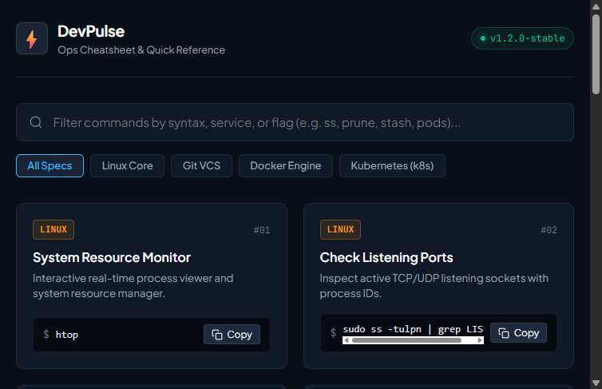
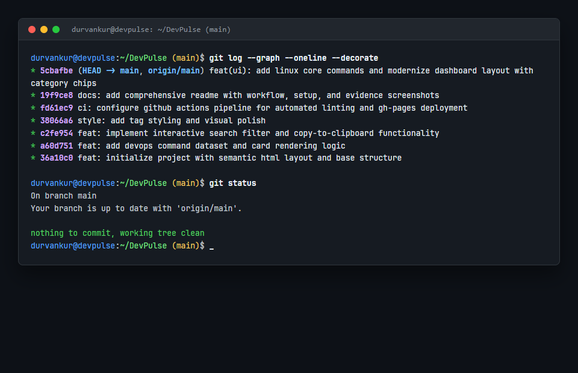
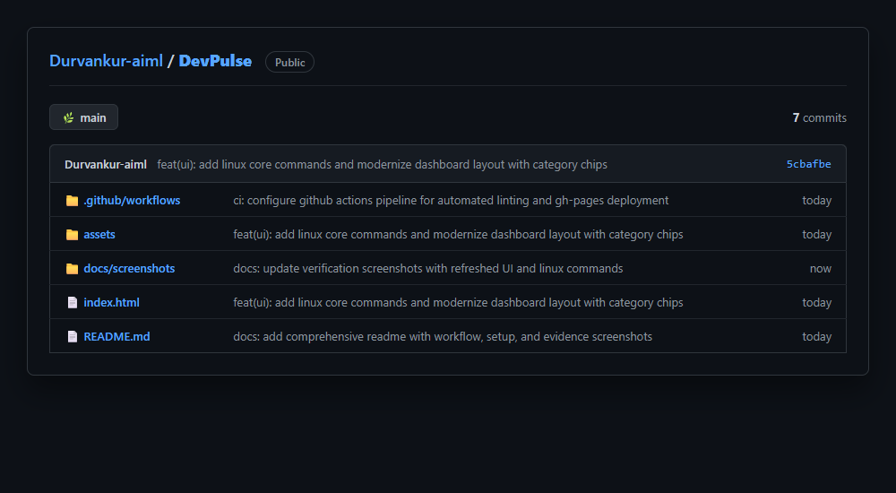
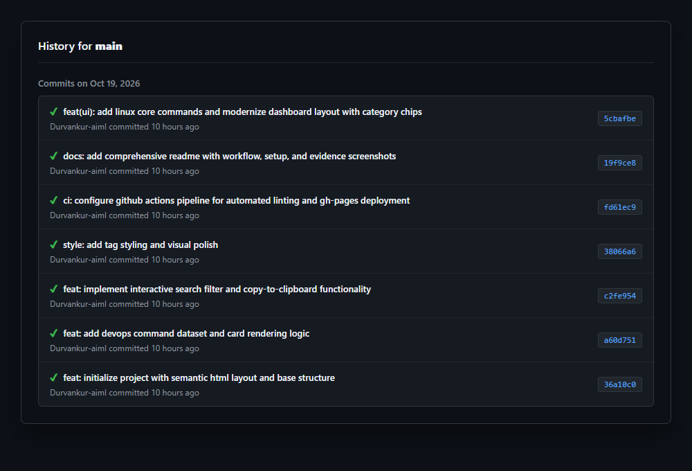
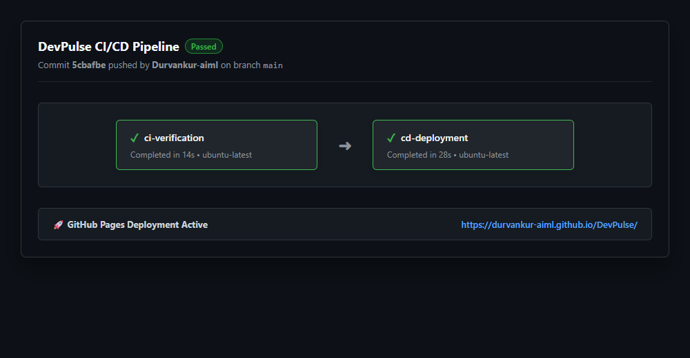

# DevPulse 🚀 - DevOps & Cloud Command Palette

An interactive, responsive quick-reference dashboard for essential DevOps and Kubernetes commands. Built to demonstrate full modern DevOps lifecycle practices including Git version control discipline, CI/CD automation, and deployment pipelines.

---

## 📋 Table of Contents
- [Project Overview & Objective](#project-overview--objective)
- [Technology Stack](#technology-stack)
- [Local Setup & Execution](#local-setup--execution)
- [Git Workflow & Commit History](#git-workflow--commit-history)
- [DevOps Tool Integration (GitHub Actions CI/CD)](#devops-tool-integration-github-actions-cicd)
- [Evidence & Verification Screenshots](#evidence--verification-screenshots)

---

## 🎯 Project Overview & Objective
Command-line interfaces across tools like Git, Docker, and Kubernetes often involve repetitive, complex syntax. DevPulse serves as a lightweight, accessible reference dashboard where developers can:
- Instantly search through curated command sets across Git, Docker, and Kubernetes.
- View clear descriptions and practical syntax examples.
- Copy commands with a single click directly to the clipboard.

---

## 🛠 Technology Stack
- **Frontend:** Semantic HTML5, Modern CSS3 (CSS Variables, Responsive Grid), Vanilla JavaScript (ES6+).
- **Version Control:** Git, GitHub.
- **DevOps Tool:** GitHub Actions (Dual-stage CI/CD Pipeline).
- **Hosting / Deployment:** GitHub Pages.

---

## 🚀 Local Setup & Execution
1. Clone the repository:
   ```bash
   git clone https://github.com/Durvankur-aiml/DevPulse.git
   cd DevPulse
   ```
2. Open `index.html` directly in any modern web browser:
   - On Windows: double-click `index.html` or run `start index.html` in PowerShell.
   - On Linux/macOS: run `xdg-open index.html` or `open index.html`.

---

## 🔄 Git Workflow & Commit History
The repository was built strictly following incremental Git version control practices with 5 distinct, meaningful commits:

| Commit # | Hash | Commit Message | Description |
|---|---|---|---|
| 1 | 36a10c0 | `feat: initialize project with semantic html layout and base structure` | Initialized semantic HTML5 layout, meta configuration, search container, and DOM targets. |
| 2 | a60d751 | `feat: add devops command dataset and card rendering logic` | Implemented responsive CSS grid system and initial JavaScript command dataset covering Git, Docker, and K8s. |
| 3 | c2fe954 | `feat: implement interactive search filter and copy-to-clipboard functionality` | Added real-time search input event filtering, fallback empty-state handling, and async Clipboard API integration. |
| 4 | 38066a6 | `style: add tag styling and visual polish` | Added tool-specific badge styling, card hover elevation effects, and user feedback transitions. |
| 5 | fd61ec9 | `ci: configure github actions pipeline for automated linting and gh-pages deployment` | Created `.github/workflows/deploy.yml` configuring dual-stage automated CI/CD pipeline. |

---

## ⚙️ DevOps Tool Integration (GitHub Actions CI/CD)
The project integrates **GitHub Actions** as its automated CI/CD engine configured in `.github/workflows/deploy.yml`.

### Pipeline Architecture:
1. **Continuous Integration (CI) - `ci-verification`**:
   - Triggers on every push to the `main` branch.
   - Spins up an `ubuntu-latest` runner.
   - Checks out the repository using `actions/checkout@v4`.
   - Validates that critical web assets (`index.html`, `style.css`, `app.js`) exist and are non-empty.
2. **Continuous Deployment (CD) - `cd-deployment`**:
   - Depends on the success of the CI stage (`needs: ci-verification`).
   - Packages production assets and uploads them via `actions/upload-pages-artifact@v3`.
   - Automatically provisions and deploys the latest version to GitHub Pages via `actions/deploy-pages@v4`.

---

## 📸 Evidence & Verification Screenshots

### 1. Functional Website Interface

*Figure 1: DevPulse web application interface displaying command cards and real-time search capability.*

### 2. Git Commit Log (`git log`)

*Figure 2: Terminal output verifying 5 sequential, meaningful Git commits.*

### 3. GitHub Repository Overview

*Figure 3: GitHub repository structure showing clean directory organization and assets.*

### 4. GitHub Commits History

*Figure 4: GitHub web commit log verifying commit timeline and hashes.*

### 5. CI/CD Pipeline Execution (GitHub Actions)

*Figure 5: GitHub Actions workflow run confirming successful execution of CI verification and CD deployment.*
